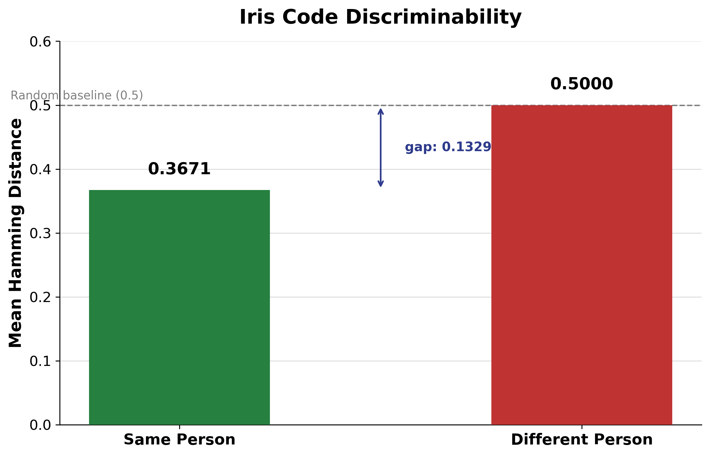

# Iris-Based Biometric Cryptosystem Using Fuzzy Vault

A MATLAB implementation of an iris-based biometric cryptosystem. A secret key is locked to a person's iris code, so the key can only be recovered when the correct iris is presented, and the iris template itself is never stored.

> **Note on terminology.** The project title uses "fuzzy vault" as the general name for biometric key-binding systems. The scheme actually implemented here is a **fuzzy commitment** (Juels and Wattenberg): a repetition code plus XOR locking. It does not use the polynomial and chaff-point construction of the Juels-Sudan fuzzy vault.

## How it works

```
Iris image -> Preprocessing -> Segmentation -> Normalization -> Gabor features -> Binary iris code
                                                                                      |
                                              Enrollment: key -> repetition code -> XOR with iris code = Vault
                                              Verification: vault XOR test code -> majority vote -> SHA-256 check
```

| Stage | Method |
|---|---|
| Preprocessing | Grayscale conversion, Gaussian smoothing |
| Segmentation | Adaptive per-image Otsu thresholding with fallback multipliers; pupil found by blob analysis |
| Normalization | Daugman rubber-sheet model, unwrapped to a 64 x 360 rectangle |
| Feature extraction | 2D Gabor filter (wavelength 8, orientation 0); phase thresholded into a 23,040-bit iris code |
| Key locking | 32-bit random key, each bit repeated 720 times, XORed with the enrollment iris code |
| Key recovery | XOR with test code, rotation search (-15 to +15 columns), majority-vote decoding |
| Verification | SHA-256 hash of the recovered key compared with the stored hash |

## Results

Tested on 30 authorized people (4 images each: 2 enrollment, 2 test) and 57 unauthorized people (305 images).

| Metric | Result |
|---|---|
| Genuine Accept Rate (GAR) | **96.67%** (29 / 30) |
| False Accept Rate, other enrolled people | **0.00%** (0 / 1,740) |
| False Accept Rate, unauthorized people | **0.00%** (0 / 9,150) |
| Mean Hamming distance, same person | 0.3671 |
| Mean Hamming distance, different person | 0.5000 |

Genuine attempts combine the two test images of each person by majority vote, giving 30 genuine trials in total. Impostor attempts use single images. With only 30 genuine trials, the GAR should be read as an indication rather than a precise estimate.



### Development notes

- **Segmentation:** Hough circle detection succeeded on 53/120 images and a fixed dark threshold on 86/120. Adaptive thresholding reached 120/120 authorized and 305/305 unauthorized images.
- **Rotation search:** Basic decoding recovered the key for only 23% of genuine attempts. Searching over small angular shifts compensates for eye misalignment between captures.
- **Key verification:** An early weighted-sum checksum had only about 529 possible values and produced a 10.6% false accept rate. Replacing it with SHA-256 brought false accepts to 0%.

## Repository structure

```
src/
  step1_segmentation.m              pupil/iris detection for all images
  step2_normalization.m             rubber-sheet unwrapping
  step3_gabor_features.m            binary iris codes + Hamming distance check
  step4_fuzzy_commitment.m          creates one vault per enrolled person
  step5_verification.m              genuine and impostor unlock tests (GAR / FAR)
  demo_identify.m                   pick any image and see who it matches, or Access Denied
  hashKey.m                         SHA-256 helper (required by steps 4, 5 and the demo)
  diagnose_segmentation_failures.m  diagnostic used to tune segmentation
charts/                             scripts that generate the result charts
results/                            result figures
```

## Running it

Requirements: MATLAB with the Image Processing Toolbox (`imgaborfilt`, `imgaussfilt`, `regionprops`).

1. Obtain the dataset (see below) and arrange it as `Dataset/Person1 ... Person30/` (files `P<n>_Enroll1/2`, `P<n>_Test1/2`) plus one folder per unauthorized subject.
2. Edit `datasetFolder` at the top of `step1_segmentation.m` and `demo_identify.m` to your dataset location.
3. Put the files in `src/` on the MATLAB path and run in order: `step1_segmentation`, `step2_normalization`, `step3_gabor_features`, `step4_fuzzy_commitment`, `step5_verification`.
4. Run `demo_identify` and choose any iris image in the file dialog.

## Dataset

Based on **CASIA-Iris-Interval** (Institute of Automation, Chinese Academy of Sciences). The images are **not included** in this repository because the dataset is distributed under its own usage terms. Please obtain it from the original source.

## Limitations and future work

- The vault struct also stores the plain key (`key` field) so that recovery can be scored during evaluation. A real deployment must store only the locked vault and the key hash.
- A repetition code is simple. Reed-Solomon or BCH codes could improve recovery.
- Eyelash and reflection masking before locking could reduce noise.
- Evaluation covers 30 enrolled people. Larger populations and live capture hardware remain to be tested.

## References

- J. Daugman, "How Iris Recognition Works", IEEE Trans. Circuits Syst. Video Technol., 2004.
- A. Juels and M. Wattenberg, "A Fuzzy Commitment Scheme", ACM CCS, 1999.
- CASIA-Iris-Interval, Institute of Automation, Chinese Academy of Sciences.
